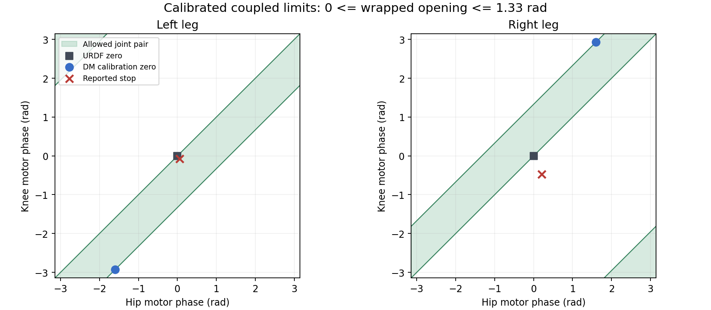

# 标定零位、offset 与髋膝联合限位

## 实车约束与测量定义

用户确认：电机标定零位是被动膝最大开角约105°，最小开角约45°。保留
`[LH,LK,RH,RK]=[-1.6,-2.93,+1.6,+2.93] rad`，四台仍使用原来的 reversed 设置。

此前采用的30–120°是错误的实车工作区假设。不能因为模型在该区间存在闭链解，就认为实车允许走到这些姿态。

本次使用Isaac Sim中19个刚体、6个闭链约束的V5模型。取髋轴H、被动膝轴K、轮轴W，
把`H-K`与`W-K`投影到被动膝轴的法平面，再计算两向量夹角。测量直接读取PhysX
`body_link_pose_w`，不调用RMCS的内角插值表。轴心的轴向错位会让不投影的三维夹角略有差别，报告同时记录两者。

接口依据[Isaac Lab资产文档](https://isaac-sim.github.io/IsaacLab/v2.3.0/source/api/lab/isaaclab.assets.html)及本机2.3版本源码。
当前会话没有可调用的Context7工具。

## Isaac测量结果

[完整42实例测量记录](wheel_leg_joint_range_45_105.json)：45–105°每5°一个姿态，
分别取三个整腿方向；另外核对URDF零位、现有offset对应的DM零位、用户异常日志姿态。
只在初始化写入从动关节状态，此后由PhysX积分1秒；固定基座，关闭重力/气簧，只给四个主动轴保持力矩。
临时解除研究资产的膝关节和气簧行程限制，避免限位把测量结果强制夹到预设值；六个闭链约束始终存在。
这些改动只在仿真stage中，未修改外部模型资产。

| 位置 | 左侧 `d=wrap(h-k)` | 右侧 `d=wrap(k-h)` | 被动膝内角 |
| --- | ---: | ---: | ---: |
| 严格45° | 约0.0018 rad | 约0.0018 rad | 45° |
| 严格105° | 约1.3296 rad | 约1.3296 rad | 105° |
| URDF零位 `[0,0,0,0]` | 0 | 0 | 约44.934° |
| 标定零位 `[-1.6,-2.93,1.6,2.93]` | 1.33 | 1.33 | 约105.021° |

最大轴心夹角误差0.000691°，最大闭链间隙0.001533 mm。这里的45–105°由实车信息给定；仿真求的是其对应的电机约束，不能代替测量实车机械止挡。

## 当前控制限位

结合现有标定的两个端点，采用：

```text
q_i = wrap(offset_i - raw_i)

d_L = wrap(q_LH - q_LK)
d_R = wrap(q_RK - q_RH)
0 <= d_L, d_R <= 1.33 rad       # 相对转角约76.205°
```

换到DM内部标定坐标，同一连续机械分支上：

```text
0 <= wrap(raw_LH - raw_LK) <= 1.33
0 <= wrap(raw_RK - raw_RH) <= 1.33
```

这是两个电机之间的联合约束。髋电机改变整腿朝向时，膝电机的允许区间要跟着移动，不能分别给四台电机套固定绝对上下限。



绿色带状区域同时显示跨±π后的等价角度；红叉为用户日志坐标。

例如保持髋电机在标定零位：

| 电机 | URDF坐标可用范围 | DM标定坐标相对行程 |
| --- | --- | --- |
| 左髋 | 固定−1.6 | 固定0 |
| 左膝 | −2.93至−1.6 | −1.33至0 |
| 右髋 | 固定+1.6 | 固定0 |
| 右膝 | +1.6至+2.93 | 0至+1.33 |

负DM相位可表示成接近2π的读数；比较相对角时必须wrap，不能直接比较原始数值。

`motor_difference_margin`改为0，两种固定角度模式正好到达工作区端点。
若仍保留0.04 rad目标余量，会把URDF零位和DM标定零位改写到区间内部，每台偏约0.02 rad。
反馈容差0.03 rad只用于接收误差判断，不放宽目标或允许继续向外运动。

内角插值仅在新工作区内用作诊断，区间外返回NaN，不再向外推算后当作真实膝角。
控制直接使用电机相对角。过零时只对整腿共同朝向选弧，开合误差不独立选短弧。

## 高增益与停在异常位置

当前实机YAML已有`angle_kp=40, max_joint_velocity=6, max_joint_acceleration=4`，本次保留这些数值。
此前仅限制速度变化率，接近目标时没有根据刹车距离提前限速；[修改前Isaac记录](wheel_leg_fast_gain_before.json)
中当前联合选弧也未收敛，两个正常实例6秒后的最大电机误差约1.407、1.370 rad。
该记录不能证明实车这一次就按同一轨迹越界。

已增加按剩余角度和加速度计算的减速上限；共同转向与半开合各预留一半电机加速度预算，继续保持速度/加速度限制及机械边界向外阻止逻辑。
扩展后的1188组两种增益、不同朝向/开合/目标的运动回归中，高增益案例修改前不能收敛，修改后通过。

用户日志`[3.03,-4.39,11.72,-27.02]°`的右侧`d=-0.67614 rad`，不符合上述工作区。
[实际DM驱动/控制器回放](wheel_leg_reported_stop_replay.json)中，即使四台status均为1，也会拒绝运动。
把同样电机坐标放入Isaac后，轴心测得右膝25.1067°，说明**当前反馈坐标、offset、方向映射与“实车始终在45–105°”这几项条件不能同时成立**。
这不是对实车膝角的直接测量，不能把仿真结果当成实物确实转到了25°，也不能通过放宽限位掩盖该矛盾。

周期日志现在同时打印目标角、控制器健康/故障原因，以及运动门控与启动阶段，避免只看到四路零速度就误认为已经到位。

## 复现

```bash
OMNI_KIT_ACCEPT_EULA=YES OPENBLAS_NUM_THREADS=1 \
  /home/noir/miniconda3/envs/isaaclab/bin/python \
  rmcs_ws/src/rmcs_core/tool/measure_wheel_leg_joint_range.py \
  --bundle /home/noir/Documents/workspace/example/wheeled-legged_RL/参考例程/model/纯底盘_v5/urdf \
  --output /tmp/wheel_leg_joint_range_45_105.json --device cpu
```

没有新增或重命名组件，插件连接不变；YAML同步新限位与目标余量。双下仍清零输出及历史状态，运行故障仍需要显式复位。

### 当前版本验证结果

开发容器内完整`rmcs_core`编译通过；`colcon test-result`汇总19项、0错误、0失败。
执行命令为`colcon build --merge-install --packages-select rmcs_core --cmake-args -DBUILD_TESTING=ON`，
以及`colcon test --merge-install --packages-select rmcs_core --ctest-args -R 'dm_motor_test|dm_joint_enable_sequence_test|wheel_leg_joint_pair_geometry_test'`。

[当前限位的完整动力学记录](wheel_leg_calibrated_limits_dynamics.json)使用16实例、真实生产DM帧解码/速度帧编码、生产控制器和使能序列，
包含有/无气簧、不等反馈/指令延迟、不同速度内环增益、两种编码器相位表示。
依次检查保持、URDF零位、标定零位、策略名义姿态、标定零点两侧往返、失能、复位再启动。

- 所有使能目标阶段最大终点误差0.0005394 rad（0.03091°）。
- 实际膝内角44.93418–105.02173°，与保留的两个标定端点一致。
- 最大闭链间隙0.05789 mm；控制器故障0；运动门控确认前非零指令0。
- 四台电机均跨过标定零点；最大速度指令3.80573 rad/s。
- 速度内环仍为仿真假设的PI，未辨识实机动力学。未在实车重新使能验证，反馈坐标不一致的问题仍不能仅凭仿真排除。

```bash
OMNI_KIT_ACCEPT_EULA=YES OPENBLAS_NUM_THREADS=1 \
  /home/noir/miniconda3/envs/isaaclab/bin/python \
  rmcs_ws/src/rmcs_core/tool/validate_wheel_leg_pair.py \
  --bundle /home/noir/Documents/workspace/example/wheeled-legged_RL/参考例程/model/纯底盘_v5/urdf \
  --output /tmp/wheel_leg_calibrated_limits_dynamics.json --device cpu --dm-feedback
```

主要实现：

- `rmcs_ws/src/rmcs_core/src/controller/chassis/wheel_leg_joint_pair_geometry.hpp`：联合限位、区间内诊断和刹车限速。
- `rmcs_ws/src/rmcs_core/src/controller/chassis/wheel_leg_joint_velocity_controller.cpp`：目标余量和诊断日志。
- `rmcs_ws/src/rmcs_bringup/config/wheel-leg-infantry-rl.yaml`：实车限位。
- `rmcs_ws/src/rmcs_core/src/hardware/wheel-leg-infantry-rl.cpp`：零速度日志同时显示门控和原因。
- `rmcs_ws/src/rmcs_core/tool/measure_wheel_leg_joint_range.py`：独立PhysX轴心测量。
- `rmcs_ws/src/rmcs_core/tool/validate_wheel_leg_pair.py`及几何回归测试：当前工作区与两个固定目标验证。
