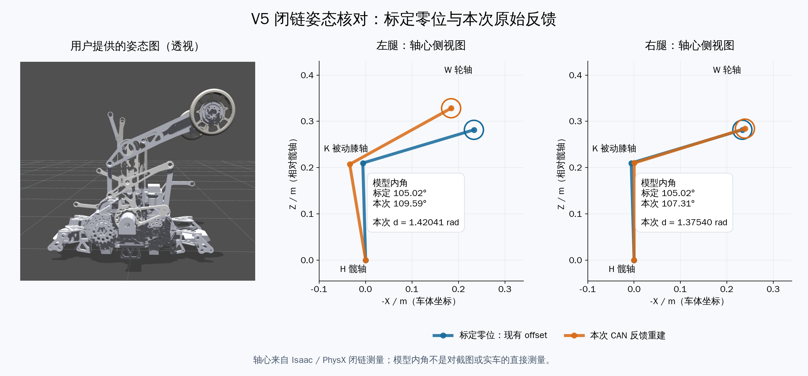

# 标定姿态的 DM 原始反馈检查

## 这次日志能确认什么

用户通过达妙调试助手设零，最初描述为把电机放回设零姿态，后来补充只是接近该姿态，
估计有 5° 以内的摆放误差。因此不能以非零读数直接判定设零失败。保留四台 reversed 和
`[LH,LK,RH,RK]=[-1.6,-2.93,+1.6,+2.93] rad`。
当前驱动关系是 `q = remainder(offset - raw, 2π)`，日志中的 angle 是转换后的关节相位，
不是调试助手显示的原始电机位置。

| 电机 | 原始相位为零时应显示的 q | 用户本次 q | 按当前配置反算的原始相位 |
| --- | ---: | ---: | ---: |
| LH | −91.673° | −127.77° | +36.097° |
| LK | −167.877° | +150.19° | +41.933° |
| RH | +91.673° | +112.56° | −20.887° |
| RK | +167.877° | −171.09° | −21.033° |

最后一列只是根据日志和当前 offset 反算出的相位，不是实车 CAN 抓包。缺少原始报文时，
不能确定未取模的原始位置，也不能确认电机内 P_MAX 与软件一致。
这些相位距零点数十度，不能仅由 ±180° 显示跳变解释。

日志中的左侧 `d=1.431854` 超过允许反馈上限 `1.360000`，控制器因此不健康，
启动阶段最终超时，四路速度保持零。这解释了停住的直接原因，尚未确定反馈不吻合的实车原因。

右侧两个电机约有共同的 21° 偏差，相对开角仍接近标定值；左侧还存在约 5.84° 的相对误差。
105° 的被动膝开角只约束髋、膝之间的相对角，不能唯一确定整腿朝向。
必须同时核实髋/整腿参考方向和髋膝相对位置；不能单凭达到最大开角判定四个电机均回到了各自零点。
这里没有把异常反馈外推成真实膝内角，也没有修改 offset 或放宽限位。

此前 Isaac 验证采用了“仿真物理姿态与电机编码器零点已经正确对应”的前提。
它验证了该前提下的闭链控制，不能证明实车零点、掉电保存或反馈定标正确。

## 两次原始 CAN 采样的新证据

第二次采样被用户描述为接近设零姿态。逐字节计算与 RMCS 一致：

| 电机 | 第二次 POS16 | 按 P_MAX=12.5 解码的 raw | 转换后 q |
| --- | --- | ---: | ---: |
| LH | 0x8162 | +7.748285° | −99.421532° |
| LK | 0x824f | +12.928379° | +179.194987° |
| RH | 0x804e | +1.715770° | +89.957478° |
| RK | 0x7fd7 | −0.885206° | +168.761840° |

四台 `status=1, fault=0, fresh=1`，使能序列 `pending_mask=0`，每台 FC 尝试一次。
这次已经全部使能；零速度由控制器拒绝当前反馈引起，不能据此归因于 CAN 失能。

| 采样 | 左侧 d | 右侧 d | 当前准入判断 |
| --- | ---: | ---: | --- |
| 第一次（LH=0x4b63，LK=0x4c50） | 1.420410 | 1.323896 | 左侧拒绝 |
| 第二次（接近设零姿态） | 1.420410 | 1.375396 | **左右两侧均拒绝** |

上限含容差为 `1.33+0.03=1.36 rad`。第二次相对标定开角的差分别为
左侧 +0.090410 rad（+5.180095°）、右侧 +0.045396 rad（+2.600976°）。
当前相对角反馈容差只有 0.03 rad（约1.719°）；近似摆回的误差可能超过它。
这里比较的是电机相对角，不是被动膝关节内角。

两次左侧 POS16 差均为 237，左髋/左膝的共同转动没有改变该相对差，
也没有因原始表示跨过零点/整圈而改变 d。第二次 LK 的 +179.194987°
与 −180.805013° 等价，因此该组拒绝不是独立关节取短弧造成的。

此前控制器遇到左侧错误即返回，掩盖了同时存在的右侧错误。
现在同一条故障原因会列出所有超限腿，控制准入、offset 和限位数值不变。
两组实车原始报文已加入驱动到几何计算的回归测试。

用户随后确认四台电机内 P_MAX 为 12.5，与软件一致，排除了该定标比例不一致。
软件自身打印的 P_MAX 仍然是配置值，不是寄存器自动读回；这里的确认来自用户。
用户随后提供了按实车当前姿态手动摆出的模型图，见下面的独立复核。
尚缺严格复现原始标定基准时的原始位置对照。这个近似姿态不能区分摆放误差、原始零点偏移
与物理边界估计误差，也不足以确定应修改哪一个 offset 或机械边界。

## 手摆模型图与 Isaac 轴心复核

用户明确说明图片为“按实车当前姿态手动摆出的模型图”，并非由 RMCS 反馈直接驱动。
它可以独立确认大腿朝上、轮子位于上方侧边的整体形态，但手动近似摆放和单视角透视
不提供精确的四个电机零位角，也不能据此重新估计编码器零偏。

使用[两组主动电机角](wheel_leg_feedback_pose_inputs.json)分别初始化 V5 模型，
在 Isaac 中保留每个实例的 19 刚体、6 个闭链约束，固定底座、关闭重力/气簧，
四个主动轴保持位置 1 秒，从动轴只在初始化写入一次。
仅在这个研究 stage 放开被动膝和气簧行程限位，以便测量反馈对应的几何解；外部资产未改动。
因此能形成闭链解不等于该姿态通过了实车工作范围检查。

| 输入 | 左模型膝内角 | 右模型膝内角 | 左 d | 右 d |
| --- | ---: | ---: | ---: | ---: |
| raw=0 + 现有 offset | 105.02166° | 105.02110° | 1.330000 | 1.330000 |
| 本次实车 CAN 反馈换算角 | 109.59152° | 107.31187° | 1.420410 | 1.375396 |

[PhysX 测量记录](wheel_leg_feedback_pose_measurement.json)：轴心夹角与独立几何计算的
最大差 0.000104°，最大闭链间隙约 0.000223 mm。
这些是模型中的测量，不能当成实车真实膝角已经被测得。



若用户估计的“5°以内”指被动膝开角，模型内角相对标定姿态的 +4.57°、+2.29°
确实处于这个量级；若指每个电机的零位误差，左侧 raw=+7.75°、+12.93° 已不在 ±5°。
两种角度不可混用。当前 0.03 rad 容差约束的是髋膝电机相对角，不是被动膝内角。

当前证据把停住定位到启动准入检查：`ever_active=0`，闭环尚未开始输出运动速度，
不能把这次停止归因于已经发生了髋膝互相竞争。
要决定修正零位还是物理边界，需以严格复现的标定基准作下一次对照；近似图不能唯一确定它们。

复现本次测量：

```bash
OMNI_KIT_ACCEPT_EULA=YES OPENBLAS_NUM_THREADS=1 \
  /home/noir/miniconda3/envs/isaaclab/bin/python \
  rmcs_ws/src/rmcs_core/tool/measure_wheel_leg_joint_range.py \
  --bundle /home/noir/Documents/workspace/example/wheeled-legged_RL/参考例程/model/纯底盘_v5/urdf \
  --motor-poses docs/zh-cn/wheel_leg_feedback_pose_inputs.json \
  --output docs/zh-cn/wheel_leg_feedback_pose_measurement.json --device cpu
```

## 新的诊断

`[wheel_leg DM feedback]` 每秒按 LH、LK、RH、RK 输出：

- CAN 总线、控制 ID、MST_ID、status/fault、反馈是否新鲜和样本年龄。
- 解码所用的 8 字节报文、POS16、未取模 `raw_rad`、取模后 `raw_phase_deg`。
- 实际使用的 offset、reversed、最终 `q_deg`、P_MAX/V_MAX/T_MAX。

`/rmcs/service/robot_status` 返回同一控制线程生成的快照，每 250 ms 更新，
并给出 `Snapshot_age_ms`。避免 ROS 服务线程同时读取正在更新的故障字符串和电机状态。
驱动的反馈时间也改为当前已解码样本的时间，避免把新报文的时间配到旧角度/状态上。

反馈字段定义已核对本机《DM-J8009-2EC 减速电机说明书 V1.0》第 5 节，
以及[厂家 SDK 的 DM_CAN.py](https://github.com/dmBots/motor-sdk/blob/main/Python%E4%BE%8B%E7%A8%8B/u2can/DM_CAN.py)。
POS16 由 D1 高字节和 D2 低字节组成，按 `[-P_MAX,+P_MAX]` 线性反映射。
P_MAX=12.5 时，原始零点附近的 POS16 是 `0x7fff/0x8000`，量化误差约 0.000191 rad。
若使用 0..2π 单圈表示，也可能出现原始角接近 2π、相位接近零的等价情况。

## 只读检查步骤

启动重新编译的程序，遥控器双下，保留当前声称的设零姿态，读取：

```bash
ros2 service call /rmcs/service/robot_status std_srvs/srv/Trigger '{}'
```

保存输出中四条 DM 数据，并记录调试助手中对应四台电机的当前位置和 P_MAX。
当前软件 P_MAX=12.5、V_MAX=45、T_MAX=54；诊断打印的是软件值，并未自动读取电机寄存器。
这一步不调用 `/wheel_leg/calibrate`，避免覆盖需要排查的零点。

判断顺序：

1. 原始相位近零、q 不等于 offset：检查实际加载配置/二进制和转换路径。
2. RMCS 原始相位与调试助手不一致：核对总线/ID、同一物理电机和 P_MAX。
3. 两边一致且原始相位不为零：核对完整物理参考姿态，以及零位是否被保存或后来改变。

## RMCS 显式校零的确认

原来 `/wheel_leg/calibrate` 只发送一次 FE 就打印“set zero”，状态服务还无条件称全部已校零。
现在 ROS 回调只提交请求，控制线程检查已失能、四台反馈新鲜、status=0 且速度小于 0.05 rad/s。
同一总线的两台电机分隔至少 5 ms，各发送一次 FE；不会自动重复写零。

只有 FE 后至少 50 ms 的新鲜反馈中，四台原始相位都在 ±0.01 rad 内、保持静止，
并且新采样覆盖至少 100 ms，才报告 `zero_feedback_confirmed`。2 秒未确认则失败。
等待或失败期间输出零速度、持续失能；失败后需显式校零并成功确认才能解除该门控。
这只确认此次姿态的反馈相位，不证明物理基准正确或掉电保存成功。

调试助手校零不会触发这套事务；`not_requested_in_RMCS` 是未知来源说明，不表示电机未校零，
也不会额外阻止控制。offset 不会由此诊断或事务修改。

## 回归范围

新增验证覆盖四组 offset 的原始零位、原始帧与已解码时间的一致性、本次日志的合成帧，
以及校零分时发送、新鲜采样确认、丢帧/非零反馈超时、拒绝陈旧反馈和运动期间拒绝写零。
合成帧验证不作为实车抓包证据。未向实车发送使能或校零命令。

开发容器内完整 `rmcs_core` 编译通过，四组相关测试全部通过；
加入两组实车报文回归后，`colcon test-result` 汇总 29 项，0 错误、0 失败。
